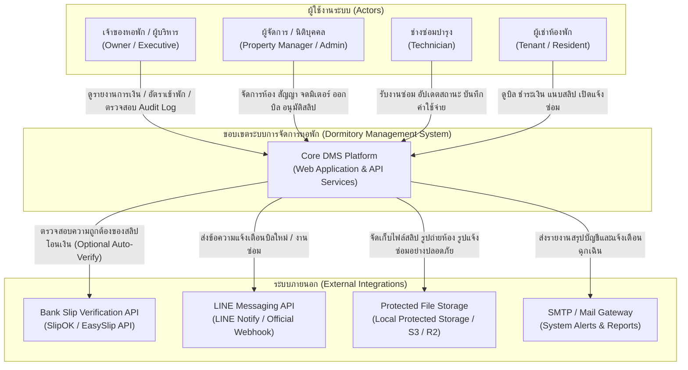
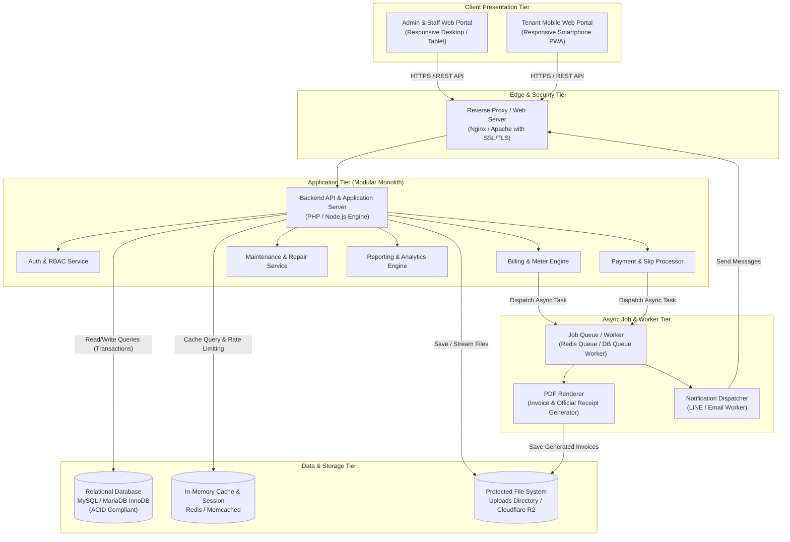
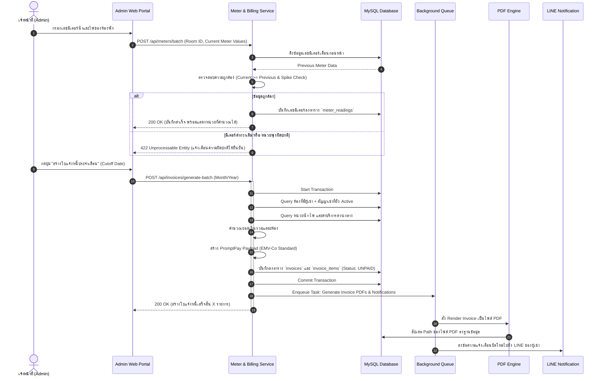
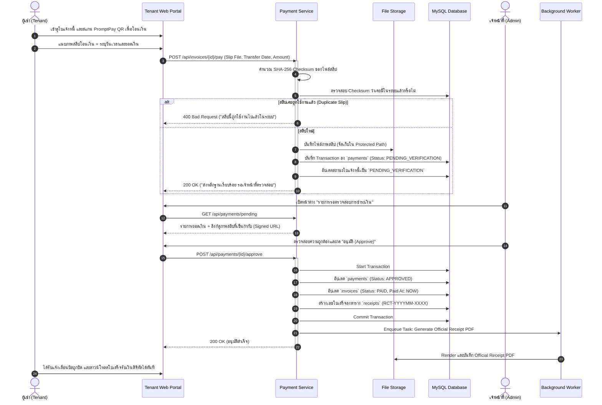
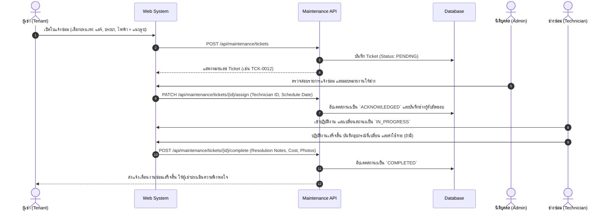
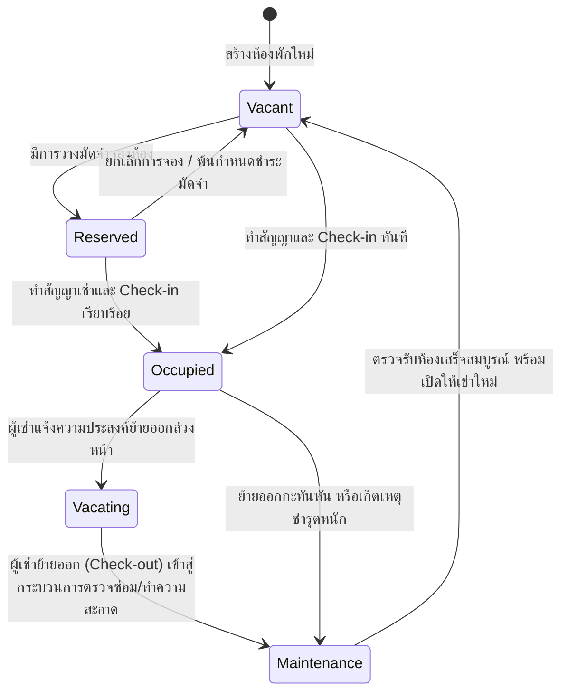
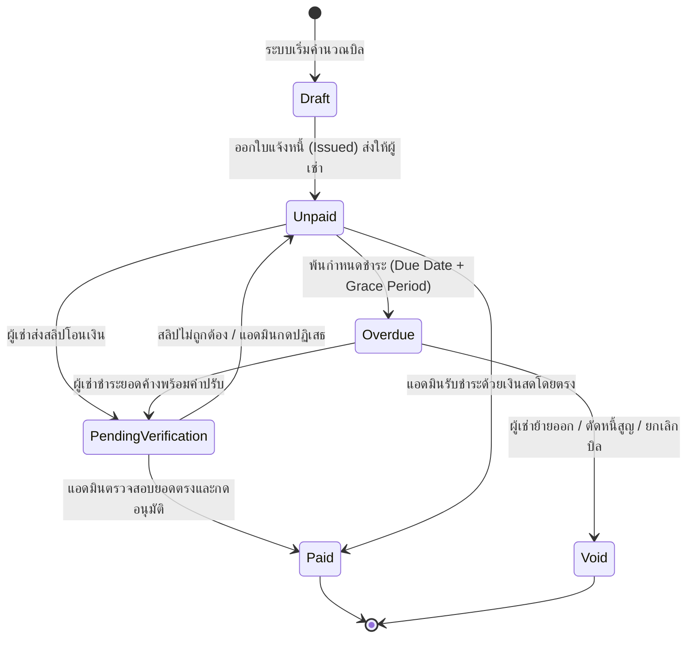
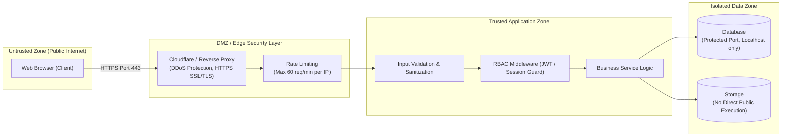

# System Design Document (SDD)
## ระบบการจัดการหอพัก (Dormitory Management System)

> **Document Version:** 1.0.0  
> **Status:** Approved / Ready for Software Architecture & Database Design  
> **Standard:** Skill 02-system-design  
> **Traceability:** Aligns with [`docs/01_requirements_specification.md`](file:///c:/xampp/htdocs/cloudflare/docs/01_requirements_specification.md)  

---

## 1. System Context & Boundaries (C4 Model - Level 1)

ระบบการจัดการหอพัก (Dormitory Management System - DMS) ทำหน้าที่เป็นแพลตฟอร์มศูนย์กลางในการบริหารจัดการอาคาร ห้องพัก ผู้เช่า การจดมิเตอร์น้ำ-ไฟ การออกบิล การรับชำระเงิน และการแจ้งซ่อมบำรุง โดยเชื่อมต่อกับผู้ใช้งาน 4 กลุ่มหลักและระบบภายนอก ดังนี้

---

## 2. High-Level Container Architecture (C4 Model - Level 2)

สถาปัตยกรรมระดับคอนเทนเนอร์เลือกใช้รูปแบบ **Modular Monolith** ซึ่งเป็นรูปแบบที่เหมาะสมที่สุดสำหรับระบบหอพัก ช่วยให้ดูแลรักษาง่าย ควบคุม Transaction การเงินแบบ ACID ได้สมบูรณ์ และมีค่าใช้จ่ายในการดำเนินงาน (Infrastructure Cost) ต่ำ

---

## 3. Component Decomposition & Responsibilities (C4 Model - Level 3)

| Component | หน้าที่หลัก (Responsibilities) | การเชื่อมต่อ (Dependencies) | Data Handled |
| :--- | :--- | :--- | :--- |
| **Authentication & RBAC** | จัดการ Session, JWT, การยืนยันตัวตน, ตรวจสอบสิทธิ์ตามบทบาท (Owner, Admin, Tech, Tenant) | Database, Cache Store | Users, Roles, Permissions, Tokens |
| **Room & Property Service** | จัดการข้อมูลอาคาร, ชั้น, ขนาดห้อง, ราคาพื้นฐาน, การเปลี่ยนสถานะห้อง | Database | Buildings, Floors, Rooms, Amenities |
| **Tenant & Contract Service** | จัดการประวัติผู้เช่า, สัญญาเช่า, บันทึกเงินประกัน, Check-in/Check-out Checklist | Database, File Store | Tenants, Contracts, Deposits, Inventory |
| **Utility Meter Engine** | บันทึกเลขมิเตอร์น้ำ-ไฟ, คำนวณผลต่างหน่วย, ตรวจสอบความผิดปกติ (Spike Warning) | Database | Meter Readings, Utility Rates, Consumption |
| **Billing & Invoicing Engine** | รวบรวมค่าเช่า+น้ำ+ไฟ, สร้าง PromptPay EMV-Co QR, คำนวณเบี้ยปรับ, จัดการรอบบิล | Database, Job Queue (PDF) | Invoices, Invoice Items, QR Codes |
| **Payment & Verification Engine** | รับไฟล์สลิป, ตรวจสอบ Hash ป้องกันสลิปซ้ำ, รองรับการตรวจสอบด้วย Slip API และ Manual Review | Database, File Store, Slip API | Payments, Slips, Bank Accounts, Receipts |
| **Maintenance Ticketing Service**| รับเรื่องแจ้งซ่อม, จัดเก็บรูปภาพ, มอบหมายงานให้ช่าง, อัปเดตสถานะ, บันทึกค่าใช้จ่าย | Database, File Store, Notif Worker| Tickets, Attachments, Repair Logs |
| **Reporting & Audit Engine** | คำนวณ Occupancy Rate, สรุปรายรับ, วิเคราะห์ยอดค้างชำระ, บันทึก Immutable Audit Log | Database | Financial Summaries, System Audit Logs |

---

## 4. Core Business Sequence Flows

### 4.1 Flow 1: การจดมิเตอร์และสร้างใบแจ้งหนี้ประจำเดือน (Meter Reading to Invoice Generation)

---

### 4.2 Flow 2: ผู้เช่าชำระเงิน ตรวจสอบสลิป และออกใบเสร็จ (Payment, Slip Check & Receipt)

---

### 4.3 Flow 3: วงจรชีวิตงานแจ้งซ่อมบำรุง (Maintenance Ticketing Lifecycle)

---

## 5. State Machine Diagrams

### 5.1 สถานะของห้องพัก (Room Lifecycle States)

### 5.2 สถานะของใบแจ้งหนี้ (Invoice Lifecycle States)

---

## 6. Storage & Data Architecture

### 6.1 Database Engine & Data Integrity
- **Database Engine:** MySQL / MariaDB โดยใช้ Storage Engine **`InnoDB`** เพื่อรองรับ Foreign Key Constraints และ Row-level Locking
- **Transaction Isolation:** ใช้ระดับ **`READ COMMITTED`** หรือ **`REPEATABLE READ`** เพื่อป้องกัน Dirty Reads ระหว่างการคำนวณบิลและการรับชำระเงิน
- **Soft Deletes:** ข้อมูลสำคัญ เช่น สัญญาเช่า (`contracts`), ใบแจ้งหนี้ (`invoices`), และผู้เช่า (`tenants`) จะใช้ Soft Delete (`deleted_at TIMESTAMP NULL`) ห้าม Hard Delete เด็ดขาด เพื่อคงความสมบูรณ์ของประวัติทางบัญชี

### 6.2 File Storage Strategy & Protection
ระบบมีไฟล์ 2 ระดับความปลอดภัย:
1. **Protected Files (ความปลอดภัยสูง):**
   - รูปถ่ายสลิปโอนเงิน (`/storage/slips/`)
   - สำเนาบัตรประชาชน/สัญญาเช่า (`/storage/contracts/`)
   - ใบเสร็จและใบแจ้งหนี้ PDF (`/storage/invoices/`)
   - *กลยุทธ์การจัดเก็บ:* ห้ามวางในโฟลเดอร์ Public Web Root โดยเด็ดขาด การเข้าถึงต้องผ่าน API Endpoint ที่มีการตรวจสอบสิทธิ์ (RBAC) หรือใช้ Temporary Signed URL ที่หมดอายุภายใน 15-30 นาที
2. **Public / General Files:**
   - รูปภาพประกอบการแจ้งซ่อม (`/storage/maintenance/`)
   - รูปภาพโปรโมตหอพัก/ภาพผังห้อง (`/storage/rooms/`)

---

## 7. Scalability, Workload & Performance Strategy

### 7.1 Workload Profile (รูปแบบภาระงาน)
- **วันปกติ (Day 6 - 22):** Traffic ต่ำถึงปานกลาง การใช้งานส่วนใหญ่คือการดูประกาศ แจ้งซ่อม และบันทึกข้อมูลทั่วไป (~100-500 requests/day)
- **วันพีคช่วงสิ้นเดือน (Day 23 - 26):** Write-heavy สำหรับการจดมิเตอร์น้ำไฟ และ Batch processing สำหรับออกบิลพร้อมกันทุกห้อง (~10,000 requests/day)
- **วันพีคช่วงต้นเดือน (Day 1 - 5):** Read-heavy และ File Upload heavy จากผู้เช่าที่เข้ามารุมดูบิล ชำระเงิน และอัปโหลดสลิป

### 7.2 Optimization Strategies
1. **Database Indexing:**
   - Index บน `invoices(room_id, billing_month, status)`
   - Index บน `meter_readings(room_id, reading_month)`
   - Unique Index บน `payments(slip_hash)` เพื่อใช้ฐานข้อมูลช่วยตัดสลิปซ้ำระดับฮาร์ดแวร์
2. **Asynchronous Job Processing:**
   - งานที่ใช้เวลาประมวลผลสูง (การแปลง HTML เป็น PDF ด้วย Dompdf / Browsershot, การส่ง LINE Notification) จะถูกผลักลง Background Queue ทันที เพื่อไม่ให้ HTTP Request ของผู้ใช้งานค้างเกิน 500ms
3. **HTTP Caching & CDN:**
   - ให้ Static Assets (CSS, JS, Web Fonts, Images) ถูกแคชผ่าน Reverse Proxy / Cloudflare CDN ด้วย Cache-Control นาน 30 วัน

---

## 8. High Availability, Resilience & Failure Handling

| สถานการณ์ขัดข้อง (Failure Scenario) | ผลกระทบที่อาจเกิดขึ้น | กลยุทธ์การรับมือ (Resilience Strategy) |
| :--- | :--- | :--- |
| **Database Connection Failure** | ผู้ใช้เปิดหน้าเว็บไม่ได้, เซฟบิลไม่สำเร็จ | แอปพลิเคชันมี Connection Retry พร้อม Exponential Backoff (3 ครั้ง); แสดงหน้าบำรุงรักษา (Graceful Error Page) |
| **สลิปอัปโหลดค้าง / Network หลุด** | ไฟล์ถูกอัปโหลดไม่สมบูรณ์ | ฝั่ง Client ตรวจสอบ File Size ก่อนส่ง; ฝั่ง Backend มี Temp File Validation และ Clean-up cron job ทุก 24 ชม. |
| **ไฟดับ / มิเตอร์น้ำไฟเสียหาย** | ไม่สามารถอ่านตัวเลขต่อเนื่องได้ | ระบบมีฟังก์ชัน "เปลี่ยนมิเตอร์ลูกใหม่" (Reset Meter) เพื่อตั้งต้นเลข 0 ใหม่ โดยมีบันทึกเหตุผลใน Audit Log |
| **LINE Notification ล่ม** | ผู้เช่าไม่ได้รับแจ้งเตือนบิลใน LINE | ระบบไม่บล็อกการออกบิล (Decoupled); ผู้เช่ายังคงดูบิลผ่าน Web Portal ได้ตามปกติ และมีคิว Retry ส่งซ้ำ 3 รอบ |
| **เซิร์ฟเวอร์หลักเสียหาย (Hardware Crash)** | ระบบหยุดทำงาน ข้อมูลเสี่ยงสูญหาย | สำรองข้อมูลฐานข้อมูลอัตโนมัติทุกคืน (Daily Automated Backup Dump) บีบอัดและส่งต่อไปยัง Offsite Cloud Storage |

---

## 9. Security Architecture & Trust Boundaries

### มาตรการความปลอดภัยหลัก:
1. **การป้องกัน Injections (SQLi & XSS):** ใช้ PDO Prepared Statements 100% ในทุกคำสั่ง SQL และ Encode HTML Output ทุกครั้งเมื่อแสดงผลข้อมูลที่ผู้ใช้กรอก
2. **การป้องกัน File Upload Attack:**
   - ตรวจสอบ File Extension และ MIME Type จากไบนารีส่วนหัวของไฟล์จริง (MIME Sniffing)
   - เปลี่ยนชื่อไฟล์เป็น Random UUID เช่น `9b1deb4d-3b7d-4bad-9bdd-2b0d7b3dcb6d.jpg`
   - ปิดสิทธิ์การรันสคริปต์ในโฟลเดอร์จัดเก็บไฟล์ (`php_flag engine off` ใน `.htaccess` หรือ Nginx `location ^~ /uploads/ { internal; }`)
3. **การป้องกัน IDOR (Insecure Direct Object References):**
   - ผู้เช่าที่ขอเปิดดูใบแจ้งหนี้ `GET /api/invoices/105` ระบบต้องตรวจสอบว่า `invoice.room_id == auth_user.room_id` เท่านั้น หากไม่ใช่ ให้ส่งกลับ `403 Forbidden`

---

## 10. Architecture Decision Records (ADR)

### ADR-01: การเลือกสถาปัตยกรรม Modular Monolith แทน Microservices
- **สถานะ:** Accepted
- **บริบท:** ระบบบริหารจัดการหอพักมีปริมาณธุรกรรมระดับปานกลาง (หอพัก 50 - 500 ห้อง) แต่มีความต้องการความแม่นยำทางบัญชีและ Transaction ความสัมพันธ์ของข้อมูลสูง
- **การตัดสินใจ:** เลือกสร้างเป็น **Modular Monolith** รวมโค้ดในโปรเจกต์เดียว แต่แบ่งเลเยอร์และโมดูลแยกขาดจากกันชัดเจน (Domain Modules)
- **ข้อดี:** ไม่มีความซับซ้อนเรื่อง Network Latency, Distributed Transactions, หรือ Service Discovery; สามารถทำ ACID Transactions ข้ามตารางได้ทันที
- **Trade-off:** ต้องคุมระเบียบการเขียนโค้ด (Coding Conventions) ไม่ให้แต่ละโมดูลผูกติดกันจนกลายเป็น Spaghetti Code

### ADR-02: การเลือกใช้ Relational Database (MySQL / MariaDB) แทน NoSQL
- **สถานะ:** Accepted
- **บริบท:** ข้อมูลของระบบหอพักประกอบด้วยข้อมูลสัญญาการเช่า เงินประกัน ยอดเงินในใบแจ้งหนี้ ประวัติการชำระเงิน ซึ่งต้องการความถูกต้องแม่นยำ 100%
- **การตัดสินใจ:** เลือกใช้ **MySQL / MariaDB (InnoDB)**
- **ข้อดี:** รองรับ Foreign Key, ACID Transactions, และ Structured Queries ที่เชื่อถือได้สูง
- **Trade-off:** การปรับโครงสร้างตาราง (Schema Migration) ต้องมีการวางแผนล่วงหน้า

### ADR-03: การประมวลผลงานหนักแบบ Asynchronous ผ่าน Background Queue
- **สถานะ:** Accepted
- **บริบท:** การแปลงบิลเป็น PDF และการส่งข้อความแจ้งเตือนผ่านภายนอก ใช้เวลาประมวลผล 1-3 วินาทีต่อรายการ หากมี 100 ห้องพร้อมกันจะทำให้ระบบค้าง
- **การตัดสินใจ:** ใช้งาน Background Queue แยกงาน PDF Rendering และการยิง Notification ออกจากวงจร HTTP Request
- **ข้อดี:** หน้าจอเว็บตอบสนองทันที (Fast UX), ป้องกัน Timeout ของ Web Server
- **Trade-off:** ต้องการ Process Worker รันทำงานเบื้องหลัง

### ADR-04: กลยุทธ์การตรวจสอบสลิปแบบผสมผสาน (Hybrid Slip Verification)
- **สถานะ:** Accepted
- **บริบท:** หอพักส่วนใหญ่ต้องการความแม่นยำ แต่การต่อ API ธนาคารของ Third-party มีค่าบริการต่อสลิป
- **การตัดสินใจ:** ออกแบบระบบรองรับทั้งสองแบบ (Hybrid):
  1. ใช้การตรวจสอบ Hash สลิปในระบบเพื่อตัดสลิปซ้ำทันที
  2. แอดมินมีหน้าจอตรวจสอบภาพสลิปและกดยืนยัน (Manual Approval)
  3. มี Interface สำหรับเชื่อมต่อ Bank Slip Verification API อัตโนมัติในอนาคตผ่าน Adapter Pattern
- **ข้อดี:** ประหยัดค่าใช้จ่ายช่วงเริ่มต้น แต่ยืดหยุ่นพอที่จะเปิดใช้งานระบบอัตโนมัติได้ทันทีเมื่อพร้อม

---

## 11. Next Step & Hand-off

เอกสารการออกแบบสถาปัตยกรรมฉบับนี้พร้อมส่งมอบต่อไปยัง:
1. **Skill 03: `03-software-architecture`** — ออกแบบ Layered Architecture, Folder Structure, DDD Entities/Value Objects, และ Service Interfaces ในระดับโค้ด
2. **Skill 04: `04-database-design`** — ออกแบบ Database Schema, Tables, Constraints, Foreign Keys, Indexes, และ Migration Scripts
