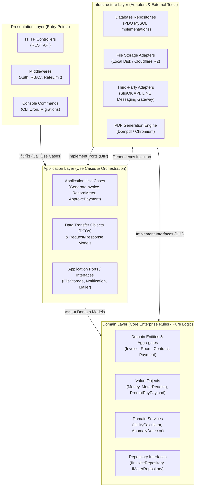
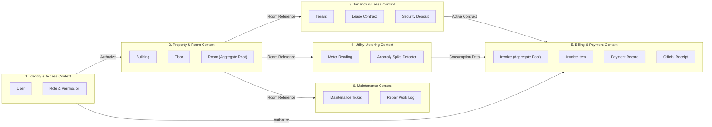

# Software Architecture Document (SAD)
## ระบบการจัดการหอพัก (Dormitory Management System)

> **Document Version:** 1.0.0  
> **Status:** Approved / Ready for Database Design  
> **Standard:** Skill 03-software-architecture  
> **Traceability:** Aligns with [`docs/01_requirements_specification.md`](file:///c:/xampp/htdocs/cloudflare/docs/01_requirements_specification.md) and [`docs/02_system_design.md`](file:///c:/xampp/htdocs/cloudflare/docs/02_system_design.md)  

---

## 1. Architectural Style & Philosophy

ระบบการจัดการหอพักเลือกใช้รูปแบบ **Modular Clean Architecture (Ports & Adapters / Hexagonal Architecture)** ภายในสถาปัตยกรรมระดับ **Modular Monolith**

### 1.1 เหตุผลและเป้าหมายการออกแบบ (Design Goals)
1. **Separation of Concerns (SoC):** แยกตรรกะทางธุรกิจ (Business Rules) ออกจากเฟรมเวิร์ก เว็บเซิร์ฟเวอร์ และฐานข้อมูลอย่างสิ้นเชิง
2. **Domain-Centric & Testability:** ส่วนที่เป็นการคำนวณเงิน ค่าน้ำ-ไฟ และค่าปรับ สามารถเขียน Unit Test ทดสอบได้ 100% โดยไม่ต้องเชื่อมต่อฐานข้อมูลหรือ HTTP Server
3. **Dependency Inversion (DIP):** เลเยอร์ชั้นใน (Domain & Application) เป็นผู้กำหนดสัญญา (Interface / Port) ส่วนเลเยอร์ภายนอก (Infrastructure) ทำหน้าที่สร้างตัวแปลง (Adapter) มาเสียบใช้งาน
4. **Maintainability & Evolvability:** หากในอนาคตต้องการเปลี่ยนระบบฐานข้อมูลจาก MySQL เป็น PostgreSQL หรือเปลี่ยนระบบจัดเก็บไฟล์จาก Local Disk เป็น Cloudflare R2 สามารถทำได้โดยแก้ไขเฉพาะส่วน Adapter ในเลเยอร์ Infrastructure โดยไม่ต้องแตะต้อง Business Logic เลยแม้แต่บรรทัดเดียว

---

## 2. Layered Architecture & Dependency Direction



### กฎการพึ่งพา (The Dependency Rule)
> **กฎเหล็ก:** ทิศทางการพึ่งพา (Dependencies) ต้องชี้เข้าสู่ศูนย์กลางเสมอ **(ชี้เข้าหา Domain)**  
> - โค้ดในโฟลเดอร์ `Domain/` **ต้องไม่มี** การเรียกใช้ฟังก์ชันเกี่ยวกับ SQL, Database, HTTP Request, Session หรือ Third-party Library ใดๆ ทั้งสิ้น
> - โค้ดใน `Application/` เรียกใช้ `Domain/` ได้เท่านั้น และคุยกับภายนอกผ่าน Interface (Ports)
> - โค้ดใน `Infrastructure/` ทำหน้าที่เป็น Adapter นำเทคโนโลยีจริง (MySQL PDO, cURL, File System) มาต่อเข้ากับ Interface

---

## 3. Bounded Contexts & Domain Model Decomposition

แบ่งระบบออกเป็น 6 ขอบเขตการทำงาน (Bounded Contexts) ที่มีขอบเขตและหน้าที่รับผิดชอบชัดเจน:



---

## 4. Directory & Folder Structure

โครงสร้างไฟล์และโฟลเดอร์ของซอร์สโค้ดตาม Clean Architecture:

```text
src/
├── Domain/                          # Enterprise Business Rules (Pure Logic)
│   ├── Shared/
│   │   ├── ValueObjects/            # Money.php, PhoneNumber.php, DateRange.php
│   │   ├── Exceptions/              # DomainException.php, InvariantViolationException.php
│   │   └── Events/                  # DomainEventInterface.php
│   ├── Property/
│   │   ├── Entities/                # Room.php, Building.php
│   │   ├── Enums/                   # RoomStatus.php (VACANT, OCCUPIED, etc.)
│   │   └── Repositories/            # RoomRepositoryInterface.php
│   ├── Tenancy/
│   │   ├── Entities/                # Tenant.php, LeaseContract.php, SecurityDeposit.php
│   │   └── Repositories/            # LeaseContractRepositoryInterface.php
│   ├── Metering/
│   │   ├── Entities/                # MeterReading.php
│   │   ├── Services/                # UtilityCalculator.php, MeterSpikeDetector.php
│   │   └── Repositories/            # MeterReadingRepositoryInterface.php
│   ├── Billing/
│   │   ├── Entities/                # Invoice.php, InvoiceItem.php
│   │   ├── ValueObjects/            # InvoiceNumber.php, PromptPayPayload.php
│   │   ├── Enums/                   # InvoiceStatus.php (UNPAID, PAID, OVERDUE)
│   │   └── Repositories/            # InvoiceRepositoryInterface.php
│   ├── Payment/
│   │   ├── Entities/                # Payment.php, Receipt.php
│   │   ├── ValueObjects/            # SlipChecksum.php
│   │   ├── Ports/                   # SlipVerificationGatewayInterface.php
│   │   └── Repositories/            # PaymentRepositoryInterface.php
│   └── Maintenance/
│       ├── Entities/                # MaintenanceTicket.php
│       ├── Enums/                   # TicketStatus.php, TicketPriority.php
│       └── Repositories/            # MaintenanceTicketRepositoryInterface.php
│
├── Application/                     # Application Business Rules (Use Cases & DTOs)
│   ├── Common/
│   │   ├── Ports/                   # FileStorageInterface.php, NotificationGatewayInterface.php
│   │   └── Transaction/             # TransactionManagerInterface.php
│   ├── Metering/
│   │   ├── Commands/                # RecordMeterReadingCommand.php
│   │   ├── DTOs/                    # MeterReadingResultDTO.php
│   │   └── UseCases/                # RecordMeterReadingUseCase.php
│   ├── Billing/
│   │   ├── Commands/                # GenerateMonthlyInvoicesCommand.php
│   │   ├── DTOs/                    # InvoiceSummaryDTO.php
│   │   └── UseCases/                # GenerateMonthlyInvoicesUseCase.php
│   ├── Payment/
│   │   ├── Commands/                # SubmitPaymentSlipCommand.php, ApprovePaymentCommand.php
│   │   └── UseCases/                # SubmitPaymentSlipUseCase.php, ApprovePaymentUseCase.php
│   └── Maintenance/
│       └── UseCases/                # CreateMaintenanceTicketUseCase.php, CloseTicketUseCase.php
│
├── Infrastructure/                  # External Adapters, Frameworks, DB & Tools
│   ├── Persistence/
│   │   ├── Connection/              # DatabaseConnection.php (PDO Singleton / Factory)
│   │   ├── MySQL/                   # MySQLInvoiceRepository.php, MySQLMeterRepository.php
│   │   └── Transaction/             # PDOTransactionManager.php
│   ├── Storage/
│   │   ├── LocalProtectedStorage.php
│   │   └── CloudflareR2Storage.php
│   ├── PDF/
│   │   └── DompdfInvoiceRenderer.php
│   ├── Notifications/
│   │   ├── LineMessagingGateway.php
│   │   └── NullNotificationGateway.php (For local dev/testing)
│   └── SlipVerification/
│       ├── ChecksumSlipVerifier.php
│       └── SlipOKApiVerifier.php
│
└── Presentation/                    # Entrypoints (HTTP Controllers, CLI, Middlewares)
    ├── Http/
    │   ├── Controllers/             # MeterController.php, InvoiceController.php, PaymentController.php
    │   ├── Middlewares/             # AuthenticateMiddleware.php, RoleMiddleware.php, RateLimit.php
    │   ├── Requests/                # RecordMeterRequest.php, SubmitSlipRequest.php
    │   └── Responses/               # JsonApiResponse.php
    └── Console/                     # CLI Scripts
        ├── GenerateInvoicesCron.php
        └── DatabaseMigrateCommand.php
```

---

## 5. Application of SOLID Principles

| หลักการ (Principle) | การประยุกต์ใช้ในระบบหอพัก (Application in DMS) | ผลลัพธ์เชิงสถาปัตยกรรม |
| :--- | :--- | :--- |
| **S - Single Responsibility** | แยก Use Case 1 คลาสต่อ 1 หน้าที่ เช่น `ApprovePaymentUseCase` มีหน้าที่เพียงตรวจสอบและอนุมัติการชำระเงิน ไม่ปะปนกับการแปลงไฟล์ PDF หรือการยิงแจ้งเตือน | โค้ดอ่านง่าย แก้ไขจุดหนึ่งไม่กระทบอีกจุดหนึ่ง Unit Test ได้ตรงจุด |
| **O - Open/Closed** | ออกแบบระบบตรวจสอบสลิปผ่าน `SlipVerificationGatewayInterface` หากต้องการเปลี่ยนจากตรวจ Hash ภายใน ไปเป็นเชื่อมต่อ SlipOK API สามารถสร้าง Class ใหม่มาเสียบได้ทันทีโดยไม่ต้องแก้โค้ด Use Case เดิม | ระบบเปิดรับการขยายฟังก์ชันใหม่ แต่ปิดการแก้ไขโค้ดเดิมที่ทำงานได้ดีอยู่แล้ว |
| **L - Liskov Substitution** | `LocalProtectedStorage` และ `CloudflareR2Storage` ทำงานผ่าน `FileStorageInterface` สามารถสลับใช้งานแทนกันได้ 100% โดยที่ Application Layer ไม่รับรู้ความแตกต่าง | สลับโหมดรัน Local บน XAMPP หรือขึ้น Cloudflare R2 ได้อย่างไร้รอยต่อ |
| **I - Interface Segregation** | แทนที่จะสร้าง `RepositoryInterface` ก้อนใหญ่ที่มีครบทุกอย่าง ให้แยก Interface ตาม Bounded Context เช่น `InvoiceRepositoryInterface` มีเฉพาะฟังก์ชันเกี่ยวกับบิล | คลาสไม่ต้อง Implement เมธอดที่ตัวเองไม่ได้ใช้งาน |
| **D - Dependency Inversion** | Use Case พึ่งพา `InvoiceRepositoryInterface` (Abstraction) แทนที่จะผูกติดกับ `MySQLInvoiceRepository` (Concrete) โดยส่งผ่าน Dependency Injection ใน Constructor | ลด Coupling ทดสอบง่ายด้วย Mock/Stub Repositories |

---

## 6. Key Domain Models & Value Objects

### 6.1 Value Object: `Money` (ป้องกัน Floating-Point Rounding Error)
ในการเงิน ห้ามใช้ `float` ในการคำนวณเงินเด็ดขาด เพราะความคลาดเคลื่อนของทศนิยม IEEE 754 อาจทำให้เศษสตางค์หายไป จึงสร้าง Value Object `Money` จัดเก็บเป็นหน่วยสตางค์ (Integer) หรือ Decimal ที่มี Scale ชัดเจน:

```php
namespace Domain\Shared\ValueObjects;

use Domain\Shared\Exceptions\InvariantViolationException;

final class Money
{
    private int $amountInSatang; // เช่น 4500.00 บาท = 450000 สตางค์
    private string $currency;

    public function __construct(int $amountInSatang, string $currency = 'THB')
    {
        if ($amountInSatang < 0) {
            throw new InvariantViolationException("ยอดเงินต้องไม่ติดลบ");
        }
        $this->amountInSatang = $amountInSatang;
        $this->currency = $currency;
    }

    public static function fromBaht(float $baht): self
    {
        return new self((int) round($baht * 100));
    }

    public function add(self $other): self
    {
        $this->assertSameCurrency($other);
        return new self($this->amountInSatang + $other->amountInSatang, $this->currency);
    }

    public function toBaht(): float
    {
        return $this->amountInSatang / 100;
    }

    public function formatted(): string
    {
        return number_format($this->toBaht(), 2) . ' ' . $this->currency;
    }

    private function assertSameCurrency(self $other): void
    {
        if ($this->currency !== $other->currency) {
            throw new InvariantViolationException("ไม่สามารถคำนวณเงินต่างสกุลได้");
        }
    }
}
```

---

### 6.2 Aggregate Root: `Invoice` (ใบแจ้งหนี้)
`Invoice` ทำหน้าที่เป็น Aggregate Root คอยควบคุมความสมบูรณ์ของข้อมูลรายการย่อย (`InvoiceItem`) และสถานะของบิล

```php
namespace Domain\Billing\Entities;

use Domain\Billing\Enums\InvoiceStatus;
use Domain\Shared\ValueObjects\Money;
use Domain\Shared\Exceptions\InvariantViolationException;

class Invoice
{
    private int $id;
    private string $invoiceNumber;
    private int $roomId;
    private int $contractId;
    private string $billingMonth; // '2026-09'
    private InvoiceStatus $status;
    /** @var InvoiceItem[] */
    private array $items = [];
    private \DateTimeImmutable $dueDate;

    public function __construct(
        string $invoiceNumber,
        int $roomId,
        int $contractId,
        string $billingMonth,
        \DateTimeImmutable $dueDate
    ) {
        $this->invoiceNumber = $invoiceNumber;
        $this->roomId = $roomId;
        $this->contractId = $contractId;
        $this->billingMonth = $billingMonth;
        $this->dueDate = $dueDate;
        $this->status = InvoiceStatus::UNPAID;
    }

    public function addItem(string $description, Money $unitPrice, int $quantity): void
    {
        if ($this->status !== InvoiceStatus::UNPAID) {
            throw new InvariantViolationException("ไม่สามารถแก้ไขรายการในบิลที่ปิดหรืออนุมัติแล้วได้");
        }
        $this->items[] = new InvoiceItem($description, $unitPrice, $quantity);
    }

    public function calculateTotalAmount(): Money
    {
        $total = Money::fromBaht(0);
        foreach ($this->items as $item) {
            $total = $total->add($item->getTotalPrice());
        }
        return $total;
    }

    public function markAsPendingVerification(): void
    {
        if ($this->status !== InvoiceStatus::UNPAID && $this->status !== InvoiceStatus::OVERDUE) {
            throw new InvariantViolationException("สถานะบิลปัจจุบันไม่อยู่ในเงื่อนไขการส่งสลิป");
        }
        $this->status = InvoiceStatus::PENDING_VERIFICATION;
    }

    public function markAsPaid(): void
    {
        if ($this->status !== InvoiceStatus::PENDING_VERIFICATION && $this->status !== InvoiceStatus::UNPAID) {
            throw new InvariantViolationException("ไม่สามารถปรับสถานะเป็น Paid ได้จากสถานะปัจจุบัน");
        }
        $this->status = InvoiceStatus::PAID;
    }
}
```

---

## 7. Core Application Interfaces & Contracts (Ports)

### 7.1 Port: `InvoiceRepositoryInterface` (Domain Persistence Contract)
```php
namespace Domain\Billing\Repositories;

use Domain\Billing\Entities\Invoice;

interface InvoiceRepositoryInterface
{
    public function findById(int $id): ?Invoice;
    public function findByRoomAndMonth(int $roomId, string $billingMonth): ?Invoice;
    /** @return Invoice[] */
    public function findUnpaidInvoicesByMonth(string $billingMonth): array;
    public function save(Invoice $invoice): void;
}
```

### 7.2 Port: `SlipVerificationGatewayInterface` (Payment Adapter Contract)
```php
namespace Domain\Payment\Ports;

use Domain\Shared\ValueObjects\Money;

interface SlipVerificationGatewayInterface
{
    /**
     * ตรวจสอบความถูกต้องของสลิปโอนเงิน
     * @return SlipVerificationResult ผลการตรวจสอบพร้อมรายละเอียดบัญชี
     */
    public function verify(string $filePath, Money $expectedAmount): SlipVerificationResult;
}
```

### 7.3 Port: `TransactionManagerInterface` (ACID Control)
```php
namespace Application\Common\Transaction;

interface TransactionManagerInterface
{
    /**
     * ดำเนินการชุดคำสั่งภายใต้ Database Transaction
     * หากเกิด Exception ระบบจะ Rollback อัตโนมัติ
     */
    public function transactional(callable $operation): mixed;
}
```

---

## 8. Sample Use Case Implementation: `ApprovePaymentUseCase`

ตัวอย่างการทำงานใน Application Layer ที่ผสานการทำงานระหว่าง Repositories, Transaction Manager, และ Notification Port ตามหลัก Clean Architecture:

```php
namespace Application\Payment\UseCases;

use Domain\Billing\Repositories\InvoiceRepositoryInterface;
use Domain\Payment\Repositories\PaymentRepositoryInterface;
use Domain\Payment\Entities\Receipt;
use Application\Common\Transaction\TransactionManagerInterface;
use Application\Common\Ports\NotificationGatewayInterface;
use Domain\Shared\Exceptions\DomainException;

class ApprovePaymentUseCase
{
    private InvoiceRepositoryInterface $invoiceRepo;
    private PaymentRepositoryInterface $paymentRepo;
    private TransactionManagerInterface $txManager;
    private NotificationGatewayInterface $notifier;

    public function __construct(
        InvoiceRepositoryInterface $invoiceRepo,
        PaymentRepositoryInterface $paymentRepo,
        TransactionManagerInterface $txManager,
        NotificationGatewayInterface $notifier
    ) {
        $this->invoiceRepo = $invoiceRepo;
        $this->paymentRepo = $paymentRepo;
        $this->txManager = $txManager;
        $this->notifier = $notifier;
    }

    public function execute(int $paymentId, int $adminUserId): void
    {
        // 1. นำคำสั่งทั้งหมดไปรันภายใต้ ACID Transaction
        $this->txManager->transactional(function () use ($paymentId, $adminUserId) {
            $payment = $this->paymentRepo->findById($paymentId);
            if (!$payment) {
                throw new DomainException("ไม่พบรายการชำระเงินหมายเลข $paymentId");
            }

            $invoice = $this->invoiceRepo->findById($payment->getInvoiceId());
            if (!$invoice) {
                throw new DomainException("ไม่พบใบแจ้งหนี้ที่เชื่อมโยงกับสลิปนี้");
            }

            // 2. ดำเนินการปรับสถานะตาม Business Invariants
            $payment->approve($adminUserId);
            $invoice->markAsPaid();

            // 3. สร้างใบเสร็จรับเงินอย่างเป็นทางการ (Official Receipt)
            $receipt = Receipt::generateForInvoice($invoice, $payment);

            // 4. บันทึกการเปลี่ยนแปลงลงฐานข้อมูล
            $this->paymentRepo->save($payment);
            $this->invoiceRepo->save($invoice);
            $this->paymentRepo->saveReceipt($receipt);

            // 5. ส่งแจ้งเตือนผู้เช่า
            $this->notifier->sendPaymentSuccessNotification($invoice->getRoomId(), $receipt->getReceiptNumber());
        });
    }
}
```

---

## 9. Architecture Decision Records (ADRs)

### ADR-05: การกำหนด Aggregate Root ใน Domain Model
- **สถานะ:** Accepted
- **บริบท:** ข้อมูลใบแจ้งหนี้มีรายการย่อย (`invoice_items`) หากปล่อยให้แก้ไขรายการย่อยแยกจากหัวบิล อาจทำให้ยอดรวมในบิลขัดแย้งกับรายการย่อย
- **การตัดสินใจ:** กำหนดให้ `Invoice` เป็น Aggregate Root เพียงตัวเดียวที่อนุญาตให้เพิ่มหรือแก้ไข `InvoiceItem` ภายนอกไม่สามารถแก้ไข `InvoiceItem` ตรงๆ ได้
- **ผลลัพธ์:** ป้องกันข้อผิดพลาดด้านการคำนวณยอดเงินรวม ช่วยให้ Business Invariants ถูกบังคับใช้เสมอ

### ADR-06: การใช้ Value Object `Money` แทน Primitive Float/Double
- **สถานะ:** Accepted
- **บริบท:** ภาษาระดับสูงคำนวณเลขทศนิยมด้วย Binary Floating Point ซึ่งมักเกิดข้อผิดพลาด เช่น `0.1 + 0.2 = 0.30000000000000004`
- **การตัดสินใจ:** สร้าง Value Object `Money` จัดเก็บเป็นจำนวนเต็มสตางค์ (Satang) ในตัวแปร และแปลงเป็นบาทเมื่อต้องการแสดงผลเท่านั้น
- **ผลลัพธ์:** ยอดเงินถูกต้อง 100% ไม่มีความคลาดเคลื่อนของเศษสตางค์ในการออกบิลและใบเสร็จ

### ADR-07: การประยุกต์ใช้ Port & Adapter กับระบบตรวจสอบสลิป (Slip Verification)
- **สถานะ:** Accepted
- **บริบท:** ในช่วงแรกผู้ใช้ต้องการระบบตรวจ Hash สลิปในเครื่อง แต่ในอนาคตอาจเชื่อมต่อ API ภายนอก เช่น SlipOK
- **การตัดสินใจ:** นิยาม `SlipVerificationGatewayInterface` ใน Domain และทำ Adapter แยกกัน
- **ผลลัพธ์:** สามารถสลับ Adapter ได้ตาม Configuration ของระบบโดยไม่ต้องแก้ไข Use Case

### ADR-08: การแยกโฟลเดอร์ไฟล์อัปโหลดเป็น Private Protected กับ Public Web
- **สถานะ:** Accepted
- **บริบท:** สลิปโอนเงินและเอกสารสัญญาเช่ามีข้อมูลส่วนบุคคล (PII) และเลขอ้างอิงบัญชีธนาคาร เสี่ยงต่อการโดนดาวน์โหลดตรงจาก URL
- **การตัดสินใจ:** ไฟล์สลิปและสัญญาจะถูกวางในโฟลเดอร์นอก Web Root และให้บริการผ่าน Controller ที่มี Middleware ตรวจสอบสิทธิ์ (Signed URL / RBAC Streaming)
- **ผลลัพธ์:** ปลอดภัยตามหลัก PDPA และ OWASP Top 10

---

## 10. Next Step & Hand-off

เมื่อโครงสร้างสถาปัตยกรรมซอฟต์แวร์ได้รับการนิยามอย่างชัดเจนแล้ว ระบบพร้อมส่งต่อไปยัง:
- **Skill 04: `04-database-design`** — ออกแบบ Schema ฐานข้อมูลเชิงสัมพันธ์ (Tables, Primary Keys, Foreign Keys, Indexes, Constraints, DDL Migrations) เพื่อรองรับ Entities และ Repositories ที่ออกแบบไว้ทั้งหมด
