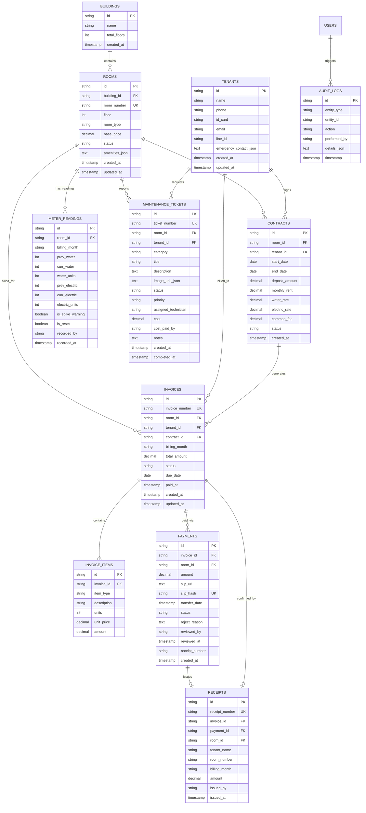

# Database Design Document (DDD)
## ระบบการจัดการหอพัก (Dormitory Management System)

> **Document Version:** 1.0.0  
> **Status:** Approved for Implementation (Phase 2)  
> **Standard:** Skill 04-database-design  
> **Target Database Engines:** MySQL / MariaDB (InnoDB) & Cloudflare D1 (SQLite Engine)  
> **Traceability:** Aligns with [`docs/01_requirements_specification.md`](file:///c:/xampp/htdocs/cloudflare/docs/01_requirements_specification.md) and [`docs/03_software_architecture.md`](file:///c:/xampp/htdocs/cloudflare/docs/03_software_architecture.md)  

---

## 1. Entity Relationship Diagram (ERD)

ไดอะแกรมแสดงความสัมพันธ์ระหว่าง 11 ตารางหลักของระบบการจัดการหอพัก:



---

## 2. Data Dictionary (พจนานุกรมข้อมูล)

### 2.1 ตาราง: `buildings` (ข้อมูลอาคาร)
| คอลัมน์ | ชนิดข้อมูล | ค่าว่าง (Null) | คีย์ | คำอธิบาย | ค่าเริ่มต้น |
| :--- | :--- | :---: | :---: | :--- | :--- |
| `id` | VARCHAR(36) | NO | PK | รหัสเฉพาะของอาคาร (UUID) | - |
| `name` | VARCHAR(100) | NO | - | ชื่ออาคาร เช่น "อาคาร A", "อาคาร B" | - |
| `total_floors` | INT | NO | - | จำนวนชั้นทั้งหมดของอาคาร | 1 |
| `created_at` | TIMESTAMP | NO | - | วันเวลาที่สร้างข้อมูล | CURRENT_TIMESTAMP |

---

### 2.2 ตาราง: `rooms` (ข้อมูลห้องพัก)
| คอลัมน์ | ชนิดข้อมูล | ค่าว่าง (Null) | คีย์ | คำอธิบาย | ข้อจำกัด (Constraints) |
| :--- | :--- | :---: | :---: | :--- | :--- |
| `id` | VARCHAR(36) | NO | PK | รหัสเฉพาะของห้อง (UUID) | - |
| `building_id` | VARCHAR(36) | NO | FK | รหัสอาคารที่ห้องตั้งอยู่ | REFERENCES `buildings(id)` |
| `room_number` | VARCHAR(20) | NO | UK | หมายเลขห้องพัก เช่น "101", "202" | UNIQUE |
| `floor` | INT | NO | - | ชั้นที่ตั้งของห้องพัก | $\ge 1$ |
| `room_type` | VARCHAR(20) | NO | - | ประเภทห้องพัก | CHECK IN ('fan', 'air', 'suite') |
| `base_price` | DECIMAL(10,2)| NO | - | อัตราค่าเช่าพื้นฐานรายเดือน (บาท) | CHECK $\ge 0$ |
| `status` | VARCHAR(20) | NO | - | สถานะห้องพัก | CHECK IN ('vacant', 'occupied', 'reserved', 'maintenance') |
| `amenities_json`| TEXT | YES | - | รายการสิ่งอำนวยความสะดวก (JSON array) | NULL |
| `created_at` | TIMESTAMP | NO | - | วันเวลาที่สร้าง | CURRENT_TIMESTAMP |
| `updated_at` | TIMESTAMP | NO | - | วันเวลาที่แก้ไขล่าสุด | CURRENT_TIMESTAMP |

---

### 2.3 ตาราง: `tenants` (ข้อมูลผู้เช่า)
| คอลัมน์ | ชนิดข้อมูล | ค่าว่าง (Null) | คีย์ | คำอธิบาย | หมายเหตุ |
| :--- | :--- | :---: | :---: | :--- | :--- |
| `id` | VARCHAR(36) | NO | PK | รหัสเฉพาะของผู้เช่า (UUID) | - |
| `name` | VARCHAR(150) | NO | - | ชื่อ-นามสกุล ผู้เช่า | - |
| `phone` | VARCHAR(30) | NO | INDEX | เบอร์โทรศัพท์หลักสำหรับติดต่อ | - |
| `id_card` | VARCHAR(20) | NO | - | เลขประจำตัวประชาชน 13 หลัก หรือ Passport | จัดเก็บแบบเข้ารหัสตาม PDPA |
| `email` | VARCHAR(100) | YES | - | อีเมลสำหรับส่งใบแจ้งหนี้ | - |
| `line_id` | VARCHAR(50) | YES | - | LINE ID สำหรับการแจ้งเตือน | - |
| `emergency_contact_json` | TEXT | YES | - | ข้อมูลผู้ติดต่อฉุกเฉิน (ชื่อ, ความสัมพันธ์, เบอร์) | JSON Object |
| `created_at` | TIMESTAMP | NO | - | วันเวลาที่ลงทะเบียนผู้เช่า | CURRENT_TIMESTAMP |
| `updated_at` | TIMESTAMP | NO | - | วันเวลาที่แก้ไขล่าสุด | CURRENT_TIMESTAMP |

---

### 2.4 ตาราง: `contracts` (สัญญาเช่าห้องพัก)
| คอลัมน์ | ชนิดข้อมูล | ค่าว่าง (Null) | คีย์ | คำอธิบาย | ข้อจำกัด (Constraints) |
| :--- | :--- | :---: | :---: | :--- | :--- |
| `id` | VARCHAR(36) | NO | PK | รหัสเฉพาะของสัญญา (UUID) | - |
| `room_id` | VARCHAR(36) | NO | FK | รหัสห้องพักที่เช่า | REFERENCES `rooms(id)` |
| `tenant_id` | VARCHAR(36) | NO | FK | รหัสผู้เช่าที่ทำสัญญา | REFERENCES `tenants(id)` |
| `start_date` | DATE | NO | - | วันเริ่มต้นสัญญาเช่า | - |
| `end_date` | DATE | NO | - | วันสิ้นสุดสัญญาเช่า | CHECK `end_date > start_date` |
| `deposit_amount`| DECIMAL(10,2)| NO | - | ยอดเงินประกันความเสียหาย (มัดจำ) | CHECK $\ge 0$ |
| `monthly_rent` | DECIMAL(10,2)| NO | - | อัตราค่าเช่าที่ตกลงในสัญญา | CHECK $\ge 0$ |
| `water_rate` | DECIMAL(6,2) | NO | - | อัตราค่าน้ำต่อหน่วย (เช่น 18.00) | DEFAULT 18.00 |
| `electric_rate`| DECIMAL(6,2) | NO | - | อัตราค่าไฟต่อหน่วย (เช่น 8.00) | DEFAULT 8.00 |
| `common_fee` | DECIMAL(10,2)| NO | - | ค่าบริการส่วนกลางรายเดือน (บาท) | DEFAULT 300.00 |
| `status` | VARCHAR(20) | NO | - | สถานะสัญญา | CHECK IN ('active', 'terminated') |
| `created_at` | TIMESTAMP | NO | - | วันเวลาที่ทำสัญญา | CURRENT_TIMESTAMP |

---

### 2.5 ตาราง: `meter_readings` (การบันทึกเลขมิเตอร์น้ำ-ไฟ)
| คอลัมน์ | ชนิดข้อมูล | ค่าว่าง (Null) | คีย์ | คำอธิบาย | ข้อจำกัด (Constraints) |
| :--- | :--- | :---: | :---: | :--- | :--- |
| `id` | VARCHAR(36) | NO | PK | รหัสเฉพาะของบันทึกมิเตอร์ | - |
| `room_id` | VARCHAR(36) | NO | FK | รหัสห้องพัก | REFERENCES `rooms(id)` |
| `billing_month` | VARCHAR(7) | NO | INDEX | รอบเดือนที่จดมิเตอร์ (เช่น "2026-09") | UNIQUE(`room_id`, `billing_month`) |
| `prev_water` | INT | NO | - | เลขมิเตอร์น้ำเดือนก่อนหน้า | $\ge 0$ |
| `curr_water` | INT | NO | - | เลขมิเตอร์น้ำปัจจุบัน | CHECK `curr_water >= prev_water OR is_reset = 1` |
| `water_units` | INT | NO | - | จำนวนหน่วยน้ำที่ใช้จริง | $\text{curr\_water} - \text{prev\_water}$ |
| `prev_electric`| INT | NO | - | เลขมิเตอร์ไฟเดือนก่อนหน้า | $\ge 0$ |
| `curr_electric`| INT | NO | - | เลขมิเตอร์ไฟปัจจุบัน | CHECK `curr_electric >= prev_electric OR is_reset = 1` |
| `electric_units`| INT | NO | - | จำนวนหน่วยไฟที่ใช้จริง | $\text{curr\_electric} - \text{prev\_electric}$ |
| `is_spike_warning`| BOOLEAN | NO | - | มีการแจ้งเตือนหน่วยพุ่งสูงหรือไม่ | DEFAULT 0 |
| `is_reset` | BOOLEAN | NO | - | มีการเปลี่ยนมิเตอร์ใหม่หรือไม่ | DEFAULT 0 |
| `recorded_by` | VARCHAR(100)| NO | - | ชื่อเจ้าหน้าที่ผู้จดมิเตอร์ | - |
| `recorded_at` | TIMESTAMP | NO | - | วันเวลาที่บันทึก | CURRENT_TIMESTAMP |

---

### 2.6 ตาราง: `invoices` (ใบแจ้งหนี้ค่าเช่า)
| คอลัมน์ | ชนิดข้อมูล | ค่าว่าง (Null) | คีย์ | คำอธิบาย | ข้อจำกัด (Constraints) |
| :--- | :--- | :---: | :---: | :--- | :--- |
| `id` | VARCHAR(36) | NO | PK | รหัสเฉพาะของใบแจ้งหนี้ | - |
| `invoice_number`| VARCHAR(50) | NO | UK | เลขที่บิล เช่น "INV-202609-101" | UNIQUE |
| `room_id` | VARCHAR(36) | NO | FK | รหัสห้องพักที่ออกบิล | REFERENCES `rooms(id)` |
| `tenant_id` | VARCHAR(36) | NO | FK | รหัสผู้เช่าที่ต้องชำระ | REFERENCES `tenants(id)` |
| `contract_id` | VARCHAR(36) | YES | FK | รหัสสัญญาเช่าที่อ้างอิง | REFERENCES `contracts(id)` |
| `billing_month` | VARCHAR(7) | NO | INDEX | รอบเดือนของบิล (เช่น "2026-09") | UNIQUE(`room_id`, `billing_month`) |
| `total_amount` | DECIMAL(10,2)| NO | - | ยอดเงินรวมสุทธิที่ต้องชำระ | CHECK $\ge 0$ |
| `status` | VARCHAR(25) | NO | INDEX | สถานะใบแจ้งหนี้ | CHECK IN ('draft', 'unpaid', 'pending_verification', 'paid', 'overdue', 'void') |
| `due_date` | DATE | NO | - | วันครบกำหนดชำระ | - |
| `paid_at` | TIMESTAMP | YES | - | วันเวลาที่ชำระเงินเสร็จสิ้น | NULL ถ้ายังไม่ชำระ |
| `created_at` | TIMESTAMP | NO | - | วันเวลาที่สร้างบิล | CURRENT_TIMESTAMP |
| `updated_at` | TIMESTAMP | NO | - | วันเวลาที่อัปเดต | CURRENT_TIMESTAMP |

---

### 2.7 ตาราง: `invoice_items` (รายการย่อยในใบแจ้งหนี้)
| คอลัมน์ | ชนิดข้อมูล | ค่าว่าง (Null) | คีย์ | คำอธิบาย | ข้อจำกัด (Constraints) |
| :--- | :--- | :---: | :---: | :--- | :--- |
| `id` | VARCHAR(36) | NO | PK | รหัสเฉพาะของรายการย่อย | - |
| `invoice_id` | VARCHAR(36) | NO | FK | รหัสใบแจ้งหนี้หลัก | REFERENCES `invoices(id)` ON DELETE CASCADE |
| `item_type` | VARCHAR(30) | NO | - | ประเภทรายการ ('rent', 'water', 'electric', 'common', 'penalty', 'other') | - |
| `description` | VARCHAR(255) | NO | - | ข้อความอธิบายรายการ | เช่น "ค่าน้ำประปา (8 หน่วย @ 18 บ.)" |
| `units` | INT | YES | - | จำนวนหน่วย (ถ้ามี) | DEFAULT 1 |
| `unit_price` | DECIMAL(10,2)| YES | - | ราคาต่อหน่วย (ถ้ามี) | DEFAULT 0 |
| `amount` | DECIMAL(10,2)| NO | - | ยอดเงินรวมของรายการนี้ | CHECK $\ge 0$ |

---

### 2.8 ตาราง: `payments` (ประวัติการชำระเงินและสลิป)
| คอลัมน์ | ชนิดข้อมูล | ค่าว่าง (Null) | คีย์ | คำอธิบาย | ข้อจำกัด (Constraints) |
| :--- | :--- | :---: | :---: | :--- | :--- |
| `id` | VARCHAR(36) | NO | PK | รหัสเฉพาะของรายการชำระเงิน | - |
| `invoice_id` | VARCHAR(36) | NO | FK | รหัสใบแจ้งหนี้ที่ชำระ | REFERENCES `invoices(id)` |
| `room_id` | VARCHAR(36) | NO | FK | รหัสห้องพัก | REFERENCES `rooms(id)` |
| `amount` | DECIMAL(10,2)| NO | - | ยอดเงินที่โอนในสลิป | CHECK $> 0$ |
| `slip_url` | TEXT | NO | - | URL / Path ไฟล์ภาพสลิป | Protected Path |
| `slip_hash` | VARCHAR(64) | NO | UK | SHA-256 Checksum ของไฟล์สลิป | UNIQUE (ตัดสลิปซ้ำ 100%) |
| `transfer_date`| TIMESTAMP | NO | - | วันเวลาที่โอนเงินระบุในสลิป | - |
| `status` | VARCHAR(20) | NO | INDEX | สถานะการตรวจสอบ | CHECK IN ('pending', 'approved', 'rejected') |
| `reject_reason`| TEXT | YES | - | เหตุผลกรณีแอดมินปฏิเสธสลิป | NULL ถ้าอนุมัติ |
| `reviewed_by` | VARCHAR(100)| YES | - | ชื่อแอดมินผู้ตรวจสอบ | - |
| `reviewed_at` | TIMESTAMP | YES | - | วันเวลาที่แอดมินกดอนุมัติ/ปฏิเสธ | - |
| `receipt_number`| VARCHAR(50)| YES | - | เลขที่ใบเสร็จรับเงินที่ออกให้ | - |
| `created_at` | TIMESTAMP | NO | - | วันเวลาที่ส่งสลิปเข้าระบบ | CURRENT_TIMESTAMP |

---

### 2.9 ตาราง: `receipts` (ใบเสร็จรับเงินอย่างเป็นทางการ)
| คอลัมน์ | ชนิดข้อมูล | ค่าว่าง (Null) | คีย์ | คำอธิบาย | ข้อจำกัด (Constraints) |
| :--- | :--- | :---: | :---: | :--- | :--- |
| `id` | VARCHAR(36) | NO | PK | รหัสเฉพาะของใบเสร็จ | - |
| `receipt_number`| VARCHAR(50) | NO | UK | เลขที่ใบเสร็จ เช่น "RCT-202609-101" | UNIQUE |
| `invoice_id` | VARCHAR(36) | NO | FK | รหัสใบแจ้งหนี้ที่ชำระ | REFERENCES `invoices(id)` |
| `payment_id` | VARCHAR(36) | NO | FK | รหัสรายการชำระเงิน | REFERENCES `payments(id)` |
| `room_id` | VARCHAR(36) | NO | FK | รหัสห้องพัก | REFERENCES `rooms(id)` |
| `tenant_name` | VARCHAR(150) | NO | - | ชื่อผู้เช่า ณ วันที่ออกใบเสร็จ | Denormalized Snapshot |
| `room_number` | VARCHAR(20) | NO | - | หมายเลขห้อง ณ วันที่ออกใบเสร็จ | Denormalized Snapshot |
| `billing_month`| VARCHAR(7) | NO | - | งวดประจำเดือน | - |
| `amount` | DECIMAL(10,2)| NO | - | ยอดเงินที่รับชำระ | CHECK $> 0$ |
| `issued_by` | VARCHAR(100)| NO | - | ชื่อเจ้าหน้าที่ผู้ออกใบเสร็จ | - |
| `issued_at` | TIMESTAMP | NO | - | วันเวลาที่ออกใบเสร็จ | CURRENT_TIMESTAMP |

---

### 2.10 ตาราง: `maintenance_tickets` (งานแจ้งซ่อมบำรุง)
| คอลัมน์ | ชนิดข้อมูล | ค่าว่าง (Null) | คีย์ | คำอธิบาย | ข้อจำกัด (Constraints) |
| :--- | :--- | :---: | :---: | :--- | :--- |
| `id` | VARCHAR(36) | NO | PK | รหัสเฉพาะของงานแจ้งซ่อม | - |
| `ticket_number` | VARCHAR(50) | NO | UK | เลขที่ Ticket เช่น "TCK-202609-001" | UNIQUE |
| `room_id` | VARCHAR(36) | NO | FK | รหัสห้องพักที่แจ้งซ่อม | REFERENCES `rooms(id)` |
| `tenant_id` | VARCHAR(36) | YES | FK | รหัสผู้เช่าที่แจ้งเรื่อง | REFERENCES `tenants(id)` |
| `category` | VARCHAR(30) | NO | - | หมวดหมู่อุปกรณ์ | CHECK IN ('air', 'plumbing', 'electrical', 'furniture', 'other') |
| `title` | VARCHAR(200) | NO | - | หัวข้อปัญหา | - |
| `description` | TEXT | NO | - | รายละเอียดปัญหา | - |
| `image_urls_json`| TEXT | YES | - | รายการ URL รูปภาพประกอบ (JSON) | - |
| `status` | VARCHAR(20) | NO | INDEX | สถานะงานแจ้งซ่อม | CHECK IN ('pending', 'acknowledged', 'in_progress', 'completed', 'cancelled') |
| `priority` | VARCHAR(10) | NO | - | ลำดับความสำคัญ | CHECK IN ('low', 'medium', 'high') |
| `assigned_technician`| VARCHAR(100)| YES | - | ชื่อช่างที่ได้รับมอบหมาย | - |
| `cost` | DECIMAL(10,2)| YES | - | ค่าใช้จ่าย/ค่าอะไหล่ในการซ่อม | DEFAULT 0 |
| `cost_paid_by` | VARCHAR(10) | YES | - | ผู้รับผิดชอบค่าใช้จ่าย | CHECK IN ('dorm', 'tenant') |
| `notes` | TEXT | YES | - | บันทึกความคืบหน้าของช่าง | - |
| `created_at` | TIMESTAMP | NO | - | วันเวลาที่แจ้งเรื่อง | CURRENT_TIMESTAMP |
| `completed_at` | TIMESTAMP | YES | - | วันเวลาที่ซ่อมแซมเสร็จสิ้น | NULL ถ้ายังไม่เสร็จ |

---

### 2.11 ตาราง: `audit_logs` (บันทึกประวัติการกระทำเพื่อความโปร่งใส - NFR-08)
| คอลัมน์ | ชนิดข้อมูล | ค่าว่าง (Null) | คีย์ | คำอธิบาย | หมายเหตุ |
| :--- | :--- | :---: | :---: | :--- | :--- |
| `id` | VARCHAR(36) | NO | PK | รหัสบันทึก Audit | - |
| `entity_type` | VARCHAR(50) | NO | INDEX | ตารางที่มีการแก้ไข | เช่น 'invoices', 'payments', 'meter_readings' |
| `entity_id` | VARCHAR(36) | NO | INDEX | รหัสของข้อมูลที่ถูกกระทำ | - |
| `action` | VARCHAR(50) | NO | - | การกระทำ ('CREATE', 'UPDATE', 'APPROVE', 'REJECT', 'VOID') | - |
| `performed_by` | VARCHAR(100)| NO | - | ชื่อผู้ใช้งาน/แอดมินที่กระทำ | - |
| `details_json` | TEXT | YES | - | ข้อมูลก่อนและหลังการแก้ไข (Diff) | JSON String |
| `timestamp` | TIMESTAMP | NO | INDEX | วันเวลาที่เกิดการกระทำ | CURRENT_TIMESTAMP (Immutable) |

---

## 3. Index Strategy (กลยุทธ์การทำดัชนีเพื่อประสิทธิภาพ)

ออกแบบ Index ตามรูปแบบการ Query จริงของระบบ (Query Patterns):

```sql
-- 1. Index สำหรับค้นหาบิลของห้องพักตามเดือนและสถานะ (Query บ่อยที่สุดในหน้า Billing & Tenant Portal)
CREATE INDEX idx_invoices_room_month_status ON invoices(room_id, billing_month, status);

-- 2. Index สำหรับค้นหาบิลที่ยังไม่ชำระ หรือค้างชำระ เพื่อแจ้งเตือน Overdue
CREATE INDEX idx_invoices_status_due_date ON invoices(status, due_date);

-- 3. Unique Index สำหรับตัดสลิปซ้ำระดับฮาร์ดแวร์ ป้องกัน Race Condition
CREATE UNIQUE INDEX uq_payments_slip_hash ON payments(slip_hash);

-- 4. Index สำหรับดึงสลิปที่รอตรวจสอบ (Pending Approval) ในหน้าแอดมิน
CREATE INDEX idx_payments_status_submitted ON payments(status, created_at DESC);

-- 5. Unique Index สำหรับมิเตอร์น้ำไฟประจำห้องต่อเดือน ป้องกันการกรอกซ้ำในงวดเดียวกัน
CREATE UNIQUE INDEX uq_meter_room_month ON meter_readings(room_id, billing_month);

-- 6. Index สำหรับดึงงานแจ้งซ่อมที่ยังไม่เสร็จสิ้น แยกตามความเร่งด่วน
CREATE INDEX idx_tickets_status_priority ON maintenance_tickets(status, priority, created_at DESC);

-- 7. Index สำหรับค้นหาประวัติผู้เช่าด้วยหมายเลขโทรศัพท์
CREATE INDEX idx_tenants_phone ON tenants(phone);

-- 8. Index สำหรับ Audit Logs ตามช่วงเวลาและ Entity
CREATE INDEX idx_audit_entity_time ON audit_logs(entity_type, entity_id, timestamp DESC);
```

---

## 4. Transaction Boundaries & Rules (กฎควบคุมความถูกต้องทางการเงิน)

### TX-01: การอนุมัติการชำระเงิน (Payment Approval Transaction)
```text
BEGIN TRANSACTION;
  1. SELECT * FROM payments WHERE id = :payment_id FOR UPDATE; (Row Lock)
  2. UPDATE payments SET status = 'approved', reviewed_by = :admin, reviewed_at = NOW();
  3. UPDATE invoices SET status = 'paid', paid_at = NOW() WHERE id = :invoice_id;
  4. INSERT INTO receipts (receipt_number, invoice_id, payment_id, amount, ...) VALUES (...);
  5. INSERT INTO audit_logs (entity_type, entity_id, action, ...) VALUES ('payments', :payment_id, 'APPROVE', ...);
COMMIT;
-- หากขั้นตอนใดขั้นตอนหนึ่งล้มเหลว ให้ ROLLBACK ทั้งหมด 100% ป้องกันการเกิดสถานะกึ่งสำเร็จ
```

### TX-02: การออกใบแจ้งหนี้แบบกลุ่ม (Batch Invoicing Transaction)
```text
BEGIN TRANSACTION;
  FOR EACH occupied room WITH active contract:
    1. ตรวจสอบว่ามี invoice ในรอบเดือนนี้แล้วหรือยัง (ป้องกัน Duplicate Invoice)
    2. ดึงหน่วยมิเตอร์น้ำ-ไฟจาก meter_readings
    3. INSERT INTO invoices (invoice_number, room_id, total_amount, status) VALUES (...);
    4. INSERT INTO invoice_items (invoice_id, item_type, amount, ...) VALUES (...);
  COMMIT;
```

---

## 5. Migration Plan & Rollback Strategy

โครงสร้างไฟล์ Migration ถูกแบ่งตามลำดับเวอร์ชัน:
* **`migrations/0001_initial_schema.sql`** — สร้างตารางทั้ง 11 ตาราง, Foreign Keys, Unique Constraints, และ Indexes
* **`migrations/0002_seed_data.sql`** — เติมข้อมูลเริ่มต้น Master Data (อาคาร, ห้อง 101-204, ผู้เช่าตัวอย่าง, มิเตอร์, บิล)

### แผนการย้อนกลับ (Rollback Plan):
หากเกิดข้อผิดพลาดในการ Deploy Schema ใหม่ สามารถย้อนกลับ (Down Migration) ได้อย่างปลอดภัย:
```sql
DROP TABLE IF EXISTS audit_logs;
DROP TABLE IF EXISTS maintenance_tickets;
DROP TABLE IF EXISTS receipts;
DROP TABLE IF EXISTS payments;
DROP TABLE IF EXISTS invoice_items;
DROP TABLE IF EXISTS invoices;
DROP TABLE IF EXISTS meter_readings;
DROP TABLE IF EXISTS contracts;
DROP TABLE IF EXISTS tenants;
DROP TABLE IF EXISTS rooms;
DROP TABLE IF EXISTS buildings;
```
